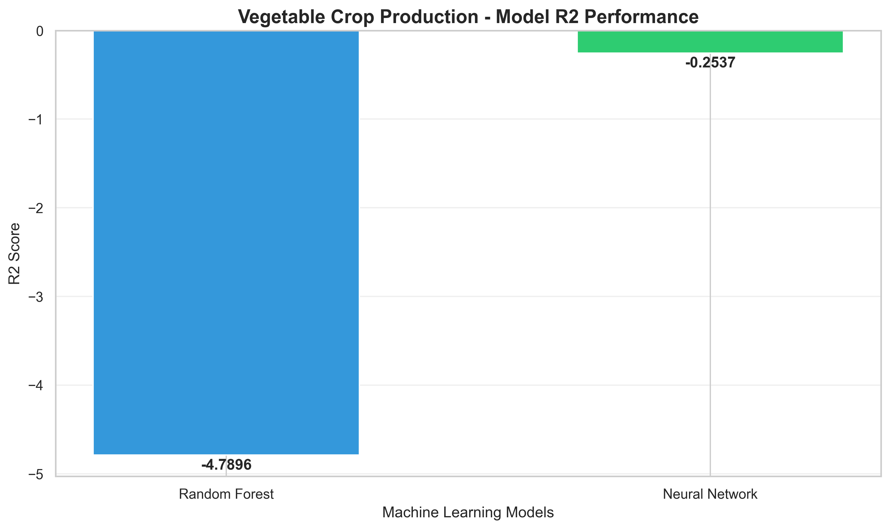
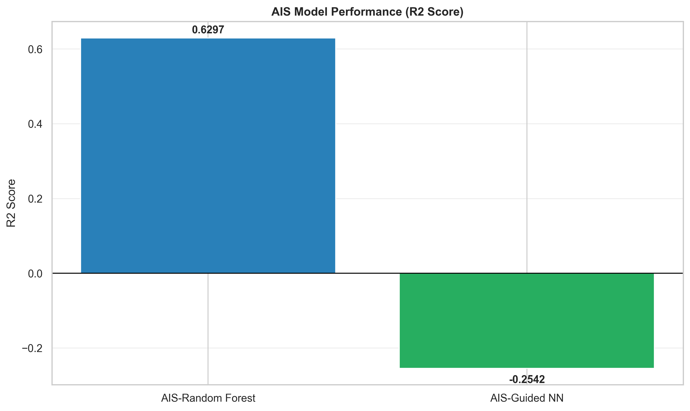
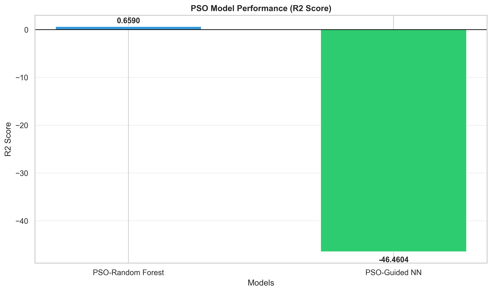
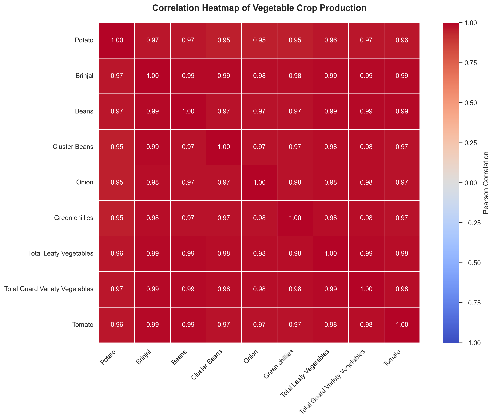
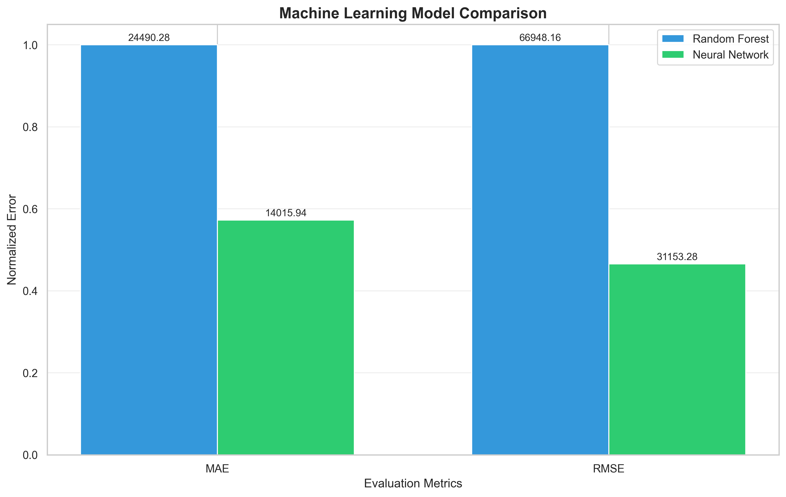
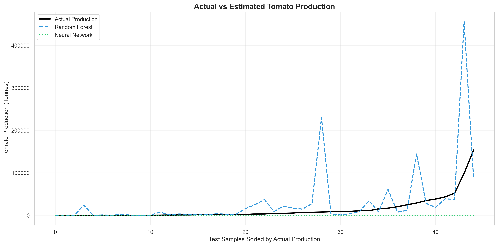
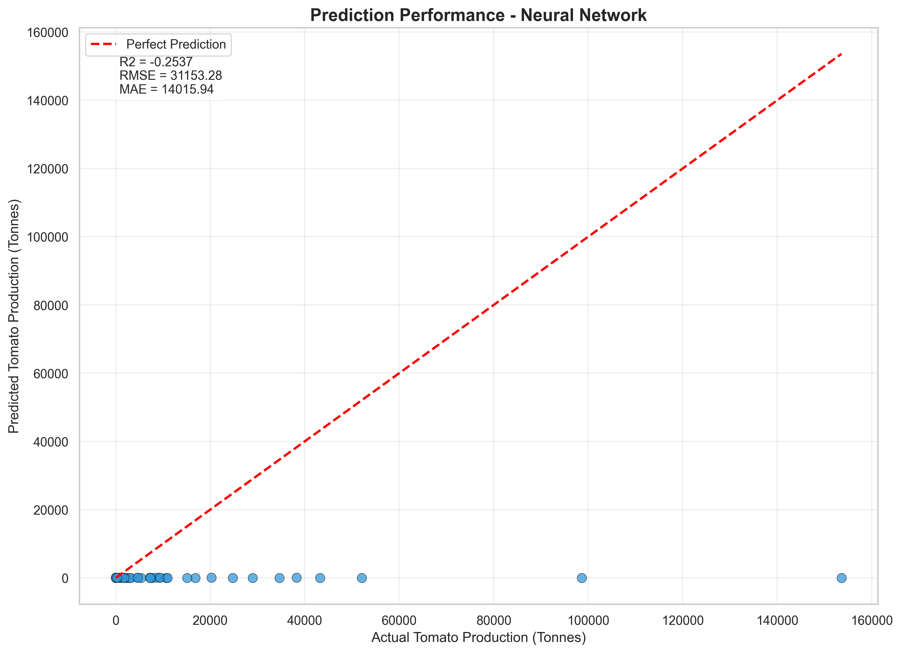
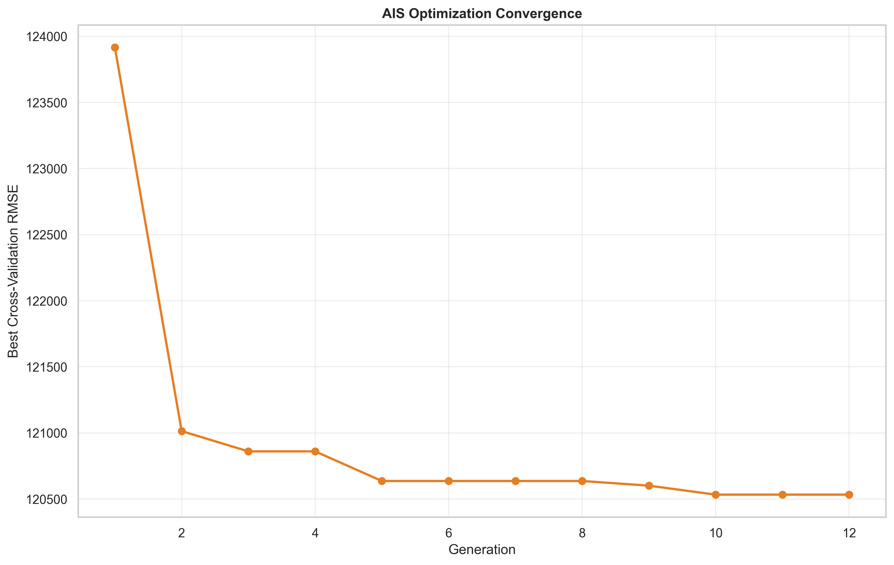
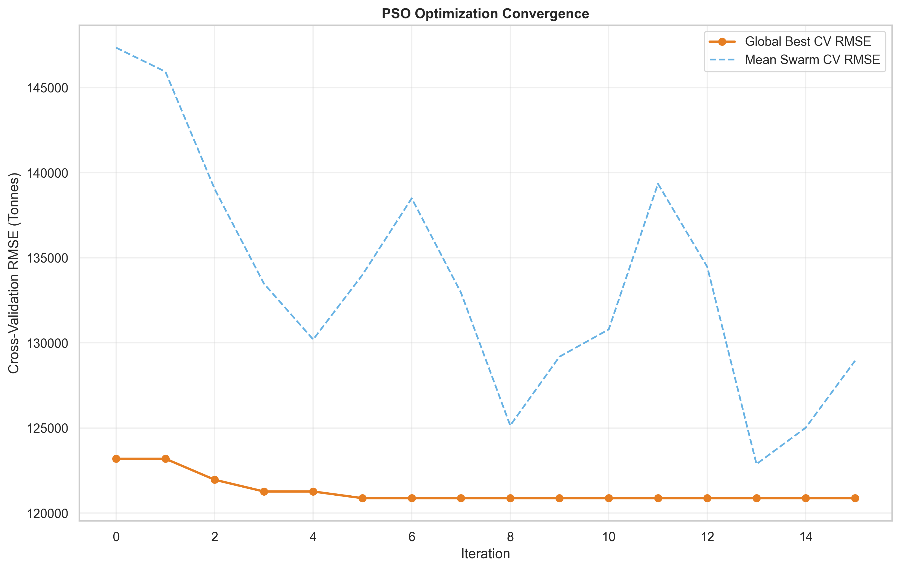

# AI-Based Vegetable Crop Production Analysis Using Machine Learning, AIS and PSO

## An Intelligent Framework for Vegetable Production Estimation, Regional Analysis, and Optimization

An AI-powered agricultural data analysis system that uses **Machine Learning (ML)**, **Deep Learning (DL)**, **Artificial Immune System (AIS)**, and **Particle Swarm Optimization (PSO)** to analyze vegetable production patterns, estimate crop production quantities, and compare optimization-based prediction models.

The project uses the **Production of Important Vegetable Crops in Tonnes (2019–20)** dataset to investigate regional crop production patterns and estimate tomato production using other vegetable production variables.

---

## 1. Project Overview

Agriculture is an important sector of the economy, and understanding crop production patterns is essential for agricultural planning, resource allocation, and food supply management.

Vegetable production varies across geographical regions due to factors such as cultivation practices, soil conditions, climate, irrigation facilities, and agricultural infrastructure.

Analyzing production records can help identify regional differences, crop relationships, and patterns that may be useful for agricultural decision-making.

This project introduces an **AI-Based Vegetable Crop Production Analysis System** that combines conventional machine learning, neural networks, and nature-inspired optimization algorithms.

The system uses three experimental approaches:

1. **Baseline Machine Learning and Deep Learning**
2. **Artificial Immune System (AIS) Optimization**
3. **Particle Swarm Optimization (PSO)**

The models estimate tomato production quantities using other vegetable production attributes.

The results are evaluated using regression metrics and visualized through graphs, correlation heatmaps, and prediction comparisons.

### Key Features

- Vegetable crop production data analysis
- Dataset cleaning and missing-value handling
- Regional production pattern exploration
- Tomato production estimation
- Random Forest regression
- Artificial Neural Network regression
- AIS-based feature selection and hyperparameter optimization
- PSO-based feature selection and hyperparameter optimization
- Regression performance evaluation
- Crop production correlation analysis
- Feature importance visualization
- Optimization convergence analysis
- Automated CSV result generation
- Model serialization in H5 and PKL formats
- YAML configuration management
- JSON metadata generation

---

## 2. Problem Statement

Vegetable production data contains useful information about agricultural output across different regions.

However, manually analyzing multiple crop categories and identifying relationships between production quantities can be time-consuming.

Traditional statistical analysis may not fully capture nonlinear relationships among agricultural production variables.

Machine learning algorithms can identify statistical relationships between crop production quantities and estimate production values.

However, model performance depends on the selection of suitable features and hyperparameters.

This project addresses these challenges by developing a machine learning framework that integrates Random Forest, neural networks, AIS, and PSO.

The primary prediction task is:

**Estimate tomato production in tonnes using the production quantities of other vegetable crops.**

The project also investigates whether nature-inspired optimization improves predictive performance compared with conventional model training.

---

## 3. Project Objectives

The major objectives are:

1. Analyze vegetable production quantities across different taluks.

2. Identify statistical relationships among vegetable crop production categories.

3. Develop machine learning models for tomato production estimation.

4. Apply Random Forest regression to model nonlinear production relationships.

5. Develop a neural network model for production estimation.

6. Apply Artificial Immune System optimization for feature selection and Random Forest hyperparameter optimization.

7. Apply Particle Swarm Optimization for feature selection and Random Forest hyperparameter optimization.

8. Compare baseline, AIS, and PSO approaches using regression metrics.

9. Generate prediction CSV files and model evaluation reports.

10. Visualize model performance, feature importance, and optimization convergence.

11. Save trained models and preprocessing artifacts for future inference.

12. Explore how production analytics may support agricultural planning.

---

## 4. Dataset Description

### Dataset Name

**Production of Important Vegetable Crops in Tonnes (2019–20)**

### Dataset File

`Production_of_Important_Vegetable_crops_In_Tonnes_2019_20.csv`

### Dataset Information

| Attribute | Description |
|---|---|
| Dataset Type | Agricultural production data |
| Observation Year | 2019–2020 |
| Original Records | 228 |
| Original Columns | 10 |
| Geographical Attribute | Taluks |
| Numerical Attributes | 9 vegetable crop categories |
| Measurement Unit | Tonnes |
| Machine Learning Task | Regression |
| Target Variable | Tomato production |

### Dataset Attributes

The dataset contains the following information:

| Attribute | Description |
|---|---|
| Taluks | Geographical administrative regions |
| Potato | Potato production in tonnes |
| Tomato | Tomato production in tonnes |
| Brinjal | Brinjal production in tonnes |
| Beans | Beans production in tonnes |
| Cluster Beans | Cluster beans production in tonnes |
| Onion | Onion production in tonnes |
| Green Chillies | Green chillies production in tonnes |
| Leafy Vegetables | Leafy vegetable production in tonnes |
| Gourd Vegetables | Gourd-variety vegetable production in tonnes |

The exact CSV column names are read directly by the implementation.

### Input Features

The model uses eight vegetable production attributes as input features.

### Target Variable

**Tomato Production (Tonnes)**

### Data Limitations

The dataset contains observations for only one agricultural year.

Therefore, the models perform cross-sectional production estimation rather than future-year forecasting.

The dataset also does not directly contain cultivated area, crop yield per hectare, soil characteristics, rainfall, fertilizer usage, or irrigation information.

Consequently, the project cannot establish causal relationships between these factors and production.

---

## 5. Proposed System

The proposed system consists of the following stages:

```text
                  Agricultural Dataset
                           |
                           v
                  Data Preprocessing
                           |
                           v
                 Missing Value Handling
                           |
                           v
                  Feature Preparation
                           |
                           v
                    Data Splitting
                           |
             +-------------+-------------+
             |             |             |
             v             v             v
         Baseline         AIS           PSO
         Models        Optimization  Optimization
             |             |             |
             v             v             v
        Random Forest  Optimized RF  Optimized RF
        Neural Network AIS-Guided NN PSO-Guided NN
             |             |             |
             +-------------+-------------+
                           |
                           v
                    Model Evaluation
                           |
                           v
                   Performance Metrics
                           |
                           v
                  Graph Visualization
                           |
                           v
                   CSV Result Export
                           |
                           v
                 Model and Metadata
                        Storage
```

---

## 6. Technologies Used

### Programming Language

- Python

### Data Processing

- Pandas
- NumPy

### Machine Learning

- Scikit-learn
- Random Forest Regressor
- K-Fold Cross-Validation

### Deep Learning

- TensorFlow
- Keras
- Artificial Neural Networks

### Optimization Algorithms

- Artificial Immune System (AIS)
- Clonal Selection Algorithm (CLONALG)
- Particle Swarm Optimization (PSO)

### Data Visualization

- Matplotlib
- Seaborn

### Model Storage

- Joblib
- HDF5 / H5

### Configuration and Metadata

- YAML
- JSON

### Development Environment

- Jupyter Notebook
- Visual Studio Code
- Python 3.x

---

## 7. Data Preprocessing

Data preprocessing is performed before training the models.

### Step 1: Load Dataset

The dataset is loaded using Pandas.

```python
import pandas as pd

df = pd.read_csv(
    "Production_of_Important_Vegetable_crops_In_Tonnes_2019_20.csv"
)
```

### Step 2: Clean Column Names

```python
df.columns = df.columns.str.strip()
```

### Step 3: Convert Numerical Columns

Crop production attributes are converted into numerical values.

Invalid values are treated as missing observations.

### Step 4: Handle Missing Values

The implementation uses median imputation for missing input feature values.

Rows with missing target values are excluded from supervised model training.

Negative crop production values are treated as invalid.

### Step 5: Feature Selection

The target variable is tomato production.

The remaining vegetable production columns are used as input features.

AIS and PSO additionally optimize the subset of input features used by their respective models.

### Step 6: Feature Scaling

StandardScaler is applied to neural network input features.

The scaling transformation is fitted using training data and applied to validation and test data.

### Step 7: Target Transformation

The neural network uses a logarithmic target transformation:

```python
y_train_log = np.log1p(y_train)
```

Predictions are converted back into tonnes using:

```python
predictions = np.expm1(predicted_log_values)
```

### Step 8: Data Splitting

The project uses an outer training and testing split:

- Training data: 80%
- Testing data: 20%
- Random state: 42

The PSO implementation also uses an internal validation split for model selection.

---

## 8. Baseline Machine Learning Models

The baseline implementation uses two regression models.

### 8.1 Random Forest Regressor

Random Forest is an ensemble learning algorithm that combines predictions from multiple decision trees.

It can capture nonlinear relationships between input features and the target variable.

The baseline Random Forest model uses:

- 200 decision trees
- Maximum tree depth of 10
- Minimum leaf size of 2
- Random state of 42

The model is trained to estimate tomato production quantities.

### Advantages

- Handles nonlinear relationships
- Supports feature importance analysis
- Requires limited feature scaling
- Can model interactions among crop production attributes

### 8.2 Artificial Neural Network

The neural network uses fully connected layers.

Architecture:

```text
Input Layer
    |
    v
Dense Layer (64 Neurons, ReLU)
    |
    v
Dropout (0.20)
    |
    v
Dense Layer (32 Neurons, ReLU)
    |
    v
Dropout (0.10)
    |
    v
Dense Layer (16 Neurons, ReLU)
    |
    v
Output Layer (1 Neuron)
```

### Neural Network Configuration

| Parameter | Value |
|---|---|
| Hidden Layers | 3 |
| Hidden Neurons | 64, 32, 16 |
| Activation | ReLU |
| Optimizer | Adam |
| Learning Rate | 0.001 |
| Maximum Epochs | 200 |
| Batch Size | 16 |
| Loss Function | Mean Squared Error |
| Early Stopping | Enabled |

The neural network is trained using the logarithmically transformed target values.

---

## 9. Artificial Immune System (AIS)

### 9.1 Introduction

Artificial Immune System is a nature-inspired optimization approach based on mechanisms observed in biological immune systems.

The project implements a Clonal Selection Algorithm inspired by the immune system's ability to identify, reproduce, and improve candidate solutions.

### 9.2 AIS Optimization Objectives

AIS is used to optimize:

- Number of Random Forest trees
- Maximum tree depth
- Minimum samples required for splitting
- Minimum samples per leaf
- Maximum features used by the Random Forest
- Input feature selection

### 9.3 Antibody Representation

Each antibody represents a candidate machine learning configuration.

```text
Antibody
   |
   +-- Number of Trees
   |
   +-- Maximum Tree Depth
   |
   +-- Minimum Split Samples
   |
   +-- Minimum Leaf Samples
   |
   +-- Maximum Features
   |
   +-- Feature Selection Mask
```

### 9.4 AIS Optimization Process

1. Initialize a population of candidate antibodies.
2. Evaluate each antibody using cross-validation.
3. Select antibodies with better fitness.
4. Clone high-performing antibodies.
5. Apply mutation to cloned antibodies.
6. Retain promising solutions.
7. Introduce new antibodies to maintain diversity.
8. Repeat until the configured number of generations is reached.

### 9.5 AIS Configuration

| Parameter | Value |
|---|---|
| Population Size | 12 |
| Generations | 12 |
| Clones per Parent | 4 |
| Elite Count | 4 |
| Mutation Rate | 0.25 |
| Cross-Validation Folds | 3 |
| Optimization Objective | Minimize RMSE |

### 9.6 AIS Fitness Function

The fitness function is based on cross-validation Root Mean Squared Error.

\[
RMSE = \sqrt{\frac{1}{n}\sum_{i=1}^{n}(y_i-\hat{y}_i)^2}
\]

The optimization searches for configurations with lower cross-validation RMSE.

### 9.7 AIS-Guided Neural Network

The AIS implementation also trains a neural network using features selected by AIS.

The neural network weights are trained using Adam.

AIS does not directly optimize the neural network weights.

---

## 10. Particle Swarm Optimization (PSO)

### 10.1 Introduction

Particle Swarm Optimization is a population-based optimization technique inspired by collective behavior observed in bird flocks and fish schools.

PSO searches for suitable solutions by updating the positions and velocities of particles in a search space.

Each particle represents a candidate model configuration.

### 10.2 PSO Optimization Objectives

PSO optimizes:

- Random Forest tree count
- Maximum tree depth
- Minimum split samples
- Minimum leaf samples
- Maximum feature fraction
- Feature selection mask

### 10.3 PSO Velocity Update

The velocity of a particle is updated using:

\[
v_i^{t+1}
=
wv_i^t
+
c_1r_1(p_i-x_i^t)
+
c_2r_2(g-x_i^t)
\]

Where:

- \(v_i\): Particle velocity
- \(w\): Inertia coefficient
- \(c_1\): Cognitive coefficient
- \(c_2\): Social coefficient
- \(r_1,r_2\): Random values
- \(p_i\): Personal best position
- \(g\): Global best position
- \(x_i\): Current particle position

The particle position is updated using:

\[
x_i^{t+1}=x_i^t+v_i^{t+1}
\]

### 10.4 PSO Configuration

| Parameter | Value |
|---|---|
| Number of Particles | 12 |
| Maximum Iterations | 15 |
| Inertia Weight | 0.7 |
| Cognitive Coefficient | 1.5 |
| Social Coefficient | 1.5 |
| Cross-Validation Folds | 3 |
| Optimization Objective | Minimize RMSE |

### 10.5 PSO Optimization Workflow

```text
Initialize Particle Swarm
           |
           v
Evaluate Particle Fitness
           |
           v
Update Personal Best
           |
           v
Update Global Best
           |
           v
Update Particle Velocity
           |
           v
Update Particle Position
           |
           v
Check Stopping Condition
           |
      +----+----+
      |         |
      No       Yes
      |         |
      v         v
   Repeat   Best Solution
                |
                v
        Train Final Models
                |
                v
         Evaluate Results
```

### 10.6 PSO-Guided Neural Network

The PSO-guided neural network uses features selected through PSO.

The neural network is subsequently trained using the Adam optimizer.

PSO does not directly optimize the neural network weights in this implementation.

---

## 11. Model Evaluation Metrics

The project evaluates regression models using the following metrics.

### 11.1 Mean Absolute Error (MAE)

\[
MAE=\frac{1}{n}\sum_{i=1}^{n}|y_i-\hat{y}_i|
\]

MAE measures the average absolute difference between actual and predicted production.

Lower MAE indicates better performance.

### 11.2 Mean Squared Error (MSE)

\[
MSE=\frac{1}{n}\sum_{i=1}^{n}(y_i-\hat{y}_i)^2
\]

MSE penalizes larger prediction errors more strongly.

### 11.3 Root Mean Squared Error (RMSE)

\[
RMSE=\sqrt{\frac{1}{n}\sum_{i=1}^{n}(y_i-\hat{y}_i)^2}
\]

RMSE measures prediction error in the original unit of the target variable.

For this project, RMSE is measured in tonnes.

### 11.4 Coefficient of Determination (R²)

\[
R^2=1-\frac{\sum_i(y_i-\hat{y}_i)^2}
{\sum_i(y_i-\bar{y})^2}
\]

R² measures the proportion of target variance explained by the model relative to a mean-prediction baseline.

Higher R² generally indicates better performance.

R² can also be negative.

**Note:** This is a regression project, so classification accuracy is not applicable. The accuracy graphs display R² scores.

---

## 12. Model Performance Visualization

### 12.1 Baseline Model Performance

The following visualization compares baseline Random Forest and neural network performance using R².



**Figure 1:** Baseline model performance comparison using R² scores.

The graph helps compare the explanatory performance of the two baseline models on the held-out test set.

### 12.2 AIS Model Performance



**Figure 2:** Performance of AIS-optimized Random Forest and AIS-guided neural network.

The graph presents R² values obtained from the AIS experiment.

### 12.3 PSO Model Performance



**Figure 3:** Performance of PSO-optimized Random Forest and PSO-guided neural network.

The graph presents the regression performance of the PSO models.

### 12.4 Crop Production Correlation Heatmap



**Figure 4:** Correlation matrix of vegetable production attributes.

The heatmap displays pairwise Pearson correlation coefficients among vegetable production quantities.

Positive values indicate positive linear relationships, while negative values indicate negative linear relationships.

Correlation does not establish causation.

### 12.5 Model Comparison



**Figure 5:** Baseline model comparison using prediction error metrics.

Lower MAE and RMSE indicate better prediction performance.

### 12.6 Actual vs Predicted Production



**Figure 6:** Comparison of actual and estimated tomato production across test observations.

The graph helps visualize prediction differences between the models.

### 12.7 Prediction Scatter Plot



**Figure 7:** Predicted versus actual tomato production.

Points closer to the diagonal reference line indicate more accurate predictions.

### 12.8 AIS Optimization Convergence



**Figure 8:** Best cross-validation RMSE across AIS generations.

The graph shows how the best observed optimization objective changes during the clonal selection process.

### 12.9 PSO Optimization Convergence



**Figure 9:** PSO optimization convergence.

The graph displays global-best cross-validation RMSE and mean swarm fitness across iterations.

---

## 13. Model Comparison Framework

The project includes six model configurations.

| Model | Optimization Approach |
|---|---|
| Baseline Random Forest | Standard hyperparameters |
| Baseline Neural Network | Adam optimization |
| AIS Random Forest | AIS hyperparameter and feature optimization |
| AIS-Guided Neural Network | AIS feature selection with Adam training |
| PSO Random Forest | PSO hyperparameter and feature optimization |
| PSO-Guided Neural Network | PSO feature selection with Adam training |

The comparison uses:

- R²
- MAE
- MSE
- RMSE

### Experimental Interpretation

Lower prediction error and higher R² indicate better regression performance.

AIS and PSO may improve model performance through feature selection and hyperparameter optimization.

However, improvements must be demonstrated using actual experimental results.

No specific improvement percentage is assumed.

For rigorous research comparisons, all models should use the same validation and test evaluation procedures.

---

## 14. Project Directory Structure

```text
AI-Based Vegetable Crop Production Analysis/
│
├── Production_of_Important_Vegetable_crops_In_Tonnes_2019_20.csv
│
├── README.md
│
├── BASELINE MODEL FILES
│   ├── vegetable_model.h5
│   ├── vegetable_model.pkl
│   ├── vegetable_scaler.pkl
│   ├── vegetable_imputer.pkl
│   ├── config.yaml
│   └── model_metadata.json
│
├── BASELINE VISUALIZATIONS
│   ├── accuracy_graph.png
│   ├── heatmap.png
│   ├── comparison_graph.png
│   ├── result_graph.png
│   ├── prediction_graph.png
│   └── feature_importance.png
│
├── BASELINE RESULTS
│   ├── result.csv
│   ├── prediction.csv
│   └── model_comparison.csv
│
├── AIS MODEL FILES
│   ├── ais_vegetable_model.h5
│   ├── ais_vegetable_model.pkl
│   ├── ais_vegetable_scaler.pkl
│   ├── ais_vegetable_imputer.pkl
│   ├── ais_config.yaml
│   └── ais_model_metadata.json
│
├── AIS VISUALIZATIONS
│   ├── ais_accuracy_graph.png
│   ├── ais_heatmap.png
│   ├── ais_comparison_graph.png
│   ├── ais_result_graph.png
│   ├── ais_prediction_graph.png
│   ├── ais_feature_importance.png
│   └── ais_convergence_graph.png
│
├── AIS RESULTS
│   ├── ais_result.csv
│   ├── ais_prediction.csv
│   └── ais_model_comparison.csv
│
├── PSO MODEL FILES
│   ├── pso_vegetable_model.h5
│   ├── pso_vegetable_model.pkl
│   ├── pso_vegetable_scaler.pkl
│   ├── pso_vegetable_imputer.pkl
│   ├── pso_config.yaml
│   └── pso_model_metadata.json
│
├── PSO VISUALIZATIONS
│   ├── pso_accuracy_graph.png
│   ├── pso_heatmap.png
│   ├── pso_comparison_graph.png
│   ├── pso_result_graph.png
│   ├── pso_prediction_graph.png
│   ├── pso_feature_importance.png
│   └── pso_convergence_graph.png
│
└── PSO RESULTS
    ├── pso_result.csv
    ├── pso_prediction.csv
    └── pso_model_comparison.csv
```

The labels such as "BASELINE MODEL FILES" represent logical file groups rather than actual folders.

---

## 15. Installation and Setup

### Step 1: Install Python

Install a compatible Python version.

Python 3.10 or 3.11 is recommended for compatibility with commonly used TensorFlow versions.

### Step 2: Download or Prepare Dataset

Place the dataset inside the project directory.

Example:

```text
C:\Users\sagni\Downloads\AI-Based Vegetable Crop Production Analysis
```

### Step 3: Install Dependencies

Run:

```bash
pip install numpy pandas scikit-learn tensorflow matplotlib seaborn joblib pyyaml h5py
```

### Step 4: Open Jupyter Notebook

```bash
jupyter notebook
```

Alternatively, open the project using Visual Studio Code.

### Step 5: Configure Dataset Path

```python
from pathlib import Path

PROJECT_DIR = Path(
    r"C:\Users\sagni\Downloads\AI-Based Vegetable Crop Production Analysis"
)

DATASET_PATH = PROJECT_DIR / (
    "Production_of_Important_Vegetable_crops_In_Tonnes_2019_20.csv"
)
```

### Step 6: Execute Baseline Model

Run the baseline training implementation.

This generates the initial trained models and preprocessing files.

### Step 7: Generate Baseline Visualizations

Run the visualization script to generate:

- `accuracy_graph.png`
- `heatmap.png`
- `comparison_graph.png`
- `result.csv`
- `result_graph.png`
- `prediction.csv`
- `prediction_graph.png`

### Step 8: Execute AIS Optimization

Run the AIS implementation.

All AIS outputs will use the `ais_` prefix.

### Step 9: Execute PSO Optimization

Run the PSO implementation.

All PSO outputs will use the `pso_` prefix.

### Step 10: Review Results

Compare model performance using the generated CSV files and graphs.

---

## 16. Model Loading and Inference

### Load Baseline Random Forest Model

```python
import joblib
import pandas as pd

model = joblib.load("vegetable_model.pkl")

# new_data must contain the same feature columns
# used during model training.

prediction = model.predict(new_data)

print("Estimated Tomato Production:", prediction)
```

### Load Baseline Neural Network

```python
import tensorflow as tf
import joblib
import numpy as np

model = tf.keras.models.load_model(
    "vegetable_model.h5",
    compile=False
)

scaler = joblib.load(
    "vegetable_scaler.pkl"
)

imputer = joblib.load(
    "vegetable_imputer.pkl"
)

# new_data must contain the original training features
# in the same order.

processed = scaler.transform(
    imputer.transform(new_data)
)

log_prediction = model.predict(processed)

prediction = np.maximum(
    np.expm1(log_prediction),
    0
)

print(prediction)
```

### Load AIS Random Forest Model

```python
import joblib

artifact = joblib.load(
    "ais_vegetable_model.pkl"
)

model = artifact["pipeline"]
features = artifact["selected_features"]

prediction = model.predict(
    new_data[features]
)

print(prediction)
```

### Load PSO Random Forest Model

```python
import joblib

artifact = joblib.load(
    "pso_vegetable_model.pkl"
)

model = artifact["pipeline"]
features = artifact["selected_features"]

prediction = model.predict(
    new_data[features]
)

print(prediction)
```

The AIS and PSO model artifacts store their selected feature names so that inference can use the correct input columns.

Only load PKL files from trusted sources.

---

## 17. Output CSV Files

### 17.1 Result CSV

The result CSV contains actual and estimated tomato production values for test observations.

Baseline output:

`result.csv`

AIS output:

`ais_result.csv`

PSO output:

`pso_result.csv`

These files contain prediction values and error measurements for the corresponding models.

### 17.2 Prediction CSV

The prediction CSV stores the selected model's predictions alongside the actual target values.

Baseline:

`prediction.csv`

AIS:

`ais_prediction.csv`

PSO:

`pso_prediction.csv`

These are held-out test-set predictions, not forecasts for future agricultural years.

### 17.3 Model Comparison CSV

The model comparison CSV contains regression evaluation metrics.

Baseline:

`model_comparison.csv`

AIS:

`ais_model_comparison.csv`

PSO:

`pso_model_comparison.csv`

These files can be combined for a broader experimental comparison.

---

## 18. Model Serialization

The project stores trained models and supporting artifacts in several formats.

### H5

HDF5 files contain trained neural network architectures and weights.

Examples:

- `vegetable_model.h5`
- `ais_vegetable_model.h5`
- `pso_vegetable_model.h5`

### PKL

PKL files store Random Forest pipelines and preprocessing objects.

Examples:

- `vegetable_model.pkl`
- `ais_vegetable_model.pkl`
- `pso_vegetable_model.pkl`

### YAML

YAML files store experiment configurations, model settings, and optimization parameters.

Examples:

- `config.yaml`
- `ais_config.yaml`
- `pso_config.yaml`

### JSON

JSON files store model metadata, selected features, performance metrics, and optimization information.

Examples:

- `model_metadata.json`
- `ais_model_metadata.json`
- `pso_model_metadata.json`

---

## 19. Expected Outcomes

The system is designed to produce:

1. Cleaned vegetable production data suitable for regression analysis.

2. Trained Random Forest and neural network models.

3. AIS-optimized Random Forest configurations.

4. PSO-optimized Random Forest configurations.

5. Feature subsets selected by AIS and PSO.

6. Regression evaluation metrics for each model.

7. Crop production correlation visualizations.

8. Actual versus predicted production graphs.

9. Optimization convergence visualizations.

10. CSV files containing model predictions and errors.

11. Serialized models for future inference.

12. An experimental framework for comparing nature-inspired optimization techniques.

Actual prediction quality depends on the dataset, training procedure, and selected model configuration.

---

## 20. Research Contributions

The project investigates the following research questions:

### RQ1

How effectively can machine learning models estimate tomato production using other vegetable production quantities?

### RQ2

Does AIS-based feature selection and hyperparameter optimization improve Random Forest regression performance?

### RQ3

Does PSO-based feature selection and hyperparameter optimization improve Random Forest regression performance?

### RQ4

How do neural networks compare with Random Forest models for the available agricultural dataset?

### RQ5

Which vegetable production attributes contribute most strongly to the fitted Random Forest predictions?

### RQ6

How do AIS and PSO differ in optimization convergence and predictive performance?

### Potential Contributions

- Comparative evaluation of baseline, AIS, and PSO approaches
- Nature-inspired feature selection for agricultural production estimation
- Optimization-assisted Random Forest regression
- Feature importance analysis
- Reproducible model configuration and metadata storage
- Automated performance visualization and result generation

These contributions should be interpreted as implementation and experimental contributions unless a broader literature review establishes novelty.

---

## 21. Applications

### Agricultural Data Analysis

The system can help researchers explore crop production patterns and regional differences.

### Regional Production Assessment

Taluk-level production data can be analyzed to identify regions with different production characteristics.

### Agricultural Research

Researchers can investigate relationships among crop production categories.

### Machine Learning Education

The project provides a practical example of regression, neural networks, hyperparameter optimization, and feature selection.

### Decision Support Research

The framework can serve as a starting point for agricultural planning tools when supplemented with additional agronomic and environmental data.

---

## 22. Limitations

The project has several limitations.

### Single-Year Dataset

The dataset covers only 2019–20.

It cannot support reliable future-year forecasting without additional historical records.

### Limited Dataset Size

The dataset contains a relatively small number of observations.

Model results may be sensitive to the train-test split and optimization settings.

### Missing Environmental Variables

The dataset does not include:

- Rainfall
- Temperature
- Soil characteristics
- Irrigation availability
- Fertilizer usage
- Cultivated area
- Crop yield per hectare

These factors may be important for agricultural production analysis.

### Production vs Productivity

The dataset measures total production in tonnes.

It does not directly measure productivity or yield per unit area.

### Model Comparison Limitations

The baseline, AIS, and PSO scripts use related but not identical model-selection procedures.

For publication-quality comparison, the experiments should use consistent validation protocols and repeated evaluations.

### Correlation vs Causation

Statistical relationships between crop production categories do not establish causal effects.

### Optimization Limitations

AIS and PSO may improve model performance, but neither guarantees better predictions.

Their effectiveness must be evaluated experimentally.

---

## 23. Future Scope

Future extensions may include:

### Multi-Year Forecasting

Integrate agricultural production data from multiple years to develop time-series forecasting models.

### Weather-Based Production Analysis

Include rainfall, temperature, humidity, and seasonal conditions.

### Soil-Based Crop Recommendation

Incorporate soil characteristics, nutrient levels, and irrigation availability.

### Agricultural Yield Prediction

Add cultivated area data to estimate yield per hectare.

### Advanced Deep Learning

Explore LSTM, GRU, Transformer, and hybrid architectures when suitable longitudinal data becomes available.

### Explainable Artificial Intelligence

Integrate SHAP and other explainability techniques to investigate model behavior.

### Hybrid Optimization

Explore combinations of AIS and PSO for feature selection and hyperparameter optimization.

### Interactive Dashboard

Develop a dashboard using Streamlit, Flask, or FastAPI.

### Geospatial Analysis

Visualize taluk-level crop production patterns using geographical boundaries.

### Deployment

Deploy trained models through web applications or REST APIs.

---

## 24. Conclusion

This project presents an AI-based framework for vegetable crop production analysis and tomato production estimation.

The system integrates conventional machine learning, deep learning, Artificial Immune System optimization, and Particle Swarm Optimization.

Random Forest and neural network models are used to estimate tomato production using other vegetable production attributes.

AIS and PSO are applied to optimize Random Forest hyperparameters and select informative input features.

The project generates evaluation metrics, prediction files, correlation heatmaps, model comparison graphs, and optimization convergence visualizations.

The resulting framework supports experimental analysis of nature-inspired optimization techniques for agricultural regression problems.

Although the current dataset is limited to a single year, the system can be extended using historical production records, weather data, soil information, and cultivated area measurements.

---

## 25. Keywords

Artificial Intelligence, Machine Learning, Deep Learning, Agriculture Analytics, Vegetable Crop Production, Tomato Production Estimation, Random Forest Regression, Artificial Neural Network, Artificial Immune System, AIS, Clonal Selection Algorithm, CLONALG, Particle Swarm Optimization, PSO, Feature Selection, Hyperparameter Optimization, Regression Analysis, Agricultural Decision Support.

---

## 26. Project Title for Academic Use

**AI-Based Vegetable Crop Production Analysis and Estimation Using Machine Learning, Artificial Immune System, and Particle Swarm Optimization**

### Research-Oriented Title

**An Optimization-Driven Machine Learning Framework for Taluk-Wise Vegetable Production Estimation Using Artificial Immune System and Particle Swarm Optimization**

---

## 27. License

This project is intended for educational, academic, and research purposes.

Dataset redistribution and reuse must comply with the terms of the original data provider.

---

## 28. Acknowledgements

This project uses open-source Python libraries and machine learning frameworks, including:

- NumPy
- Pandas
- Scikit-learn
- TensorFlow
- Keras
- Matplotlib
- Seaborn
- Joblib
- PyYAML

The project also draws on established concepts in ensemble learning, artificial neural networks, Artificial Immune Systems, and Particle Swarm Optimization.

---

**Project:** AI-Based Vegetable Crop Production Analysis

**Domain:** Artificial Intelligence and Agricultural Data Analytics

**Methods:** Random Forest, Neural Networks, AIS, PSO

**Dataset:** Production of Important Vegetable Crops in Tonnes (2019–20)

**Primary Target:** Tomato Production (Tonnes)

**Project Type:** Machine Learning and Optimization-Based Agricultural Research
